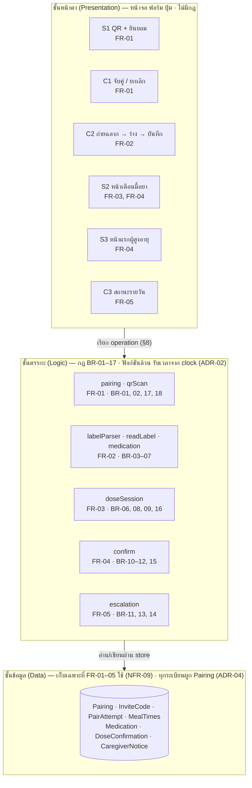
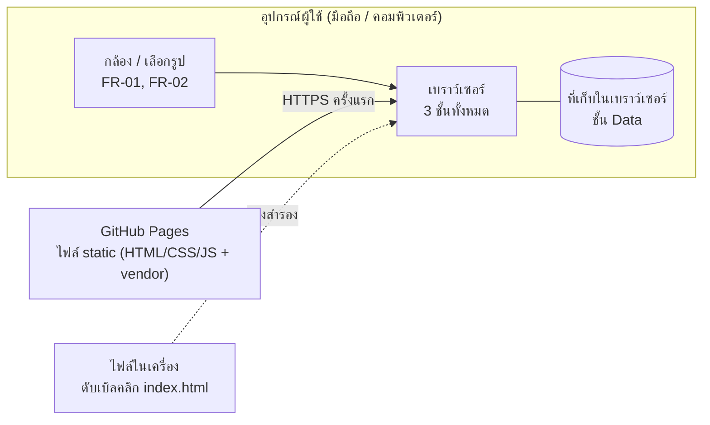
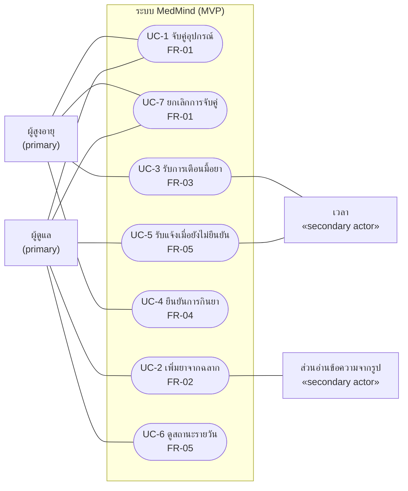
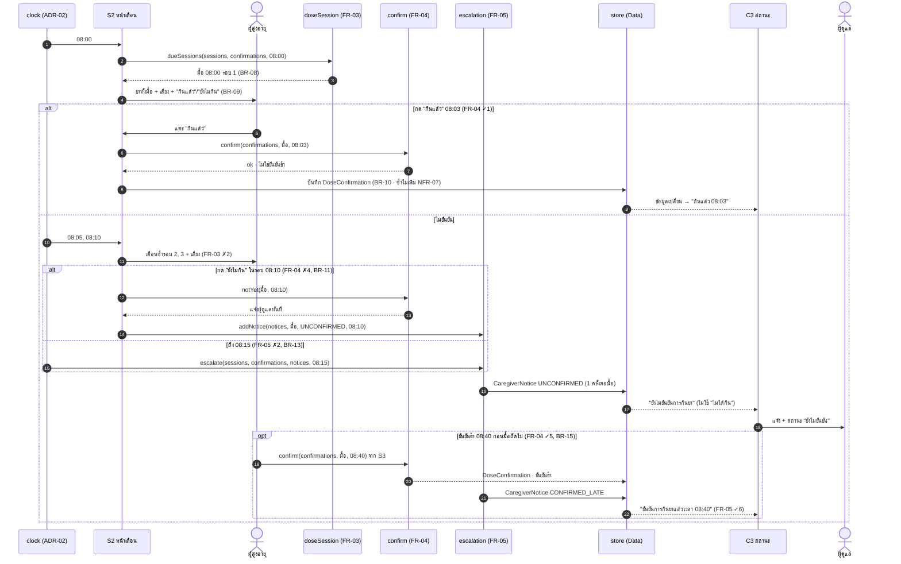
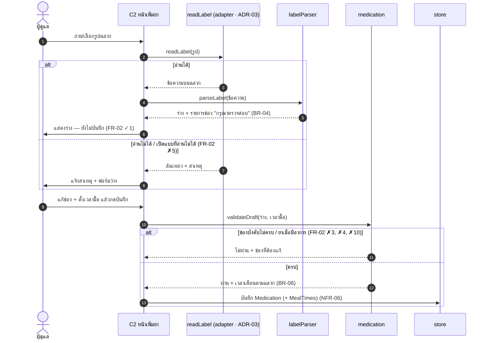
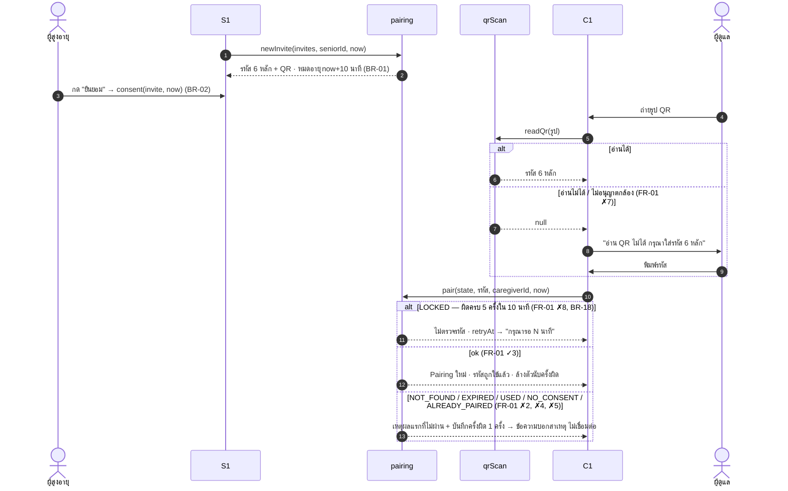
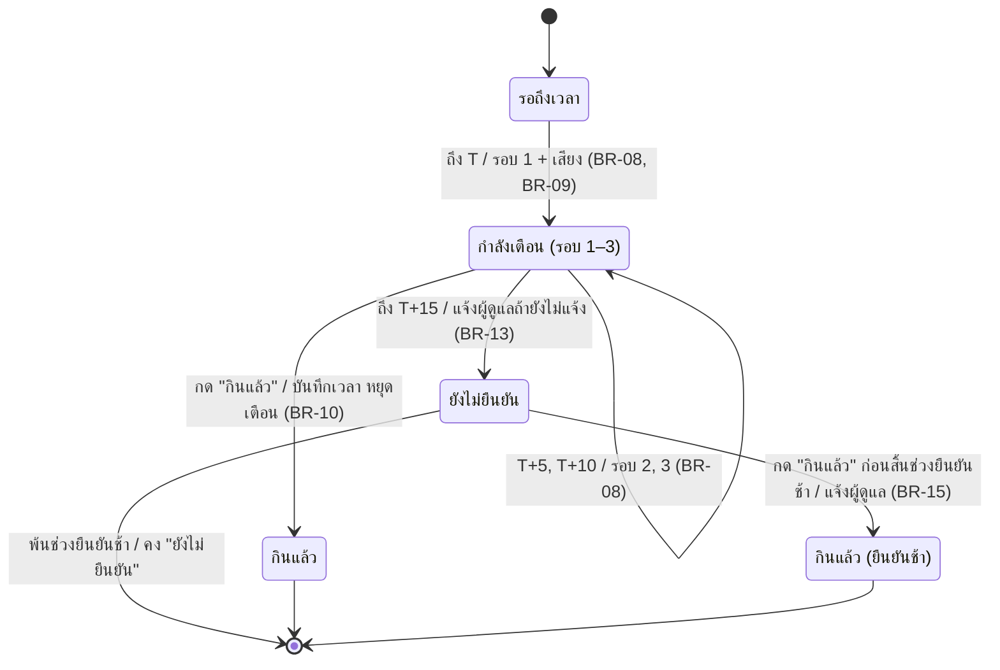
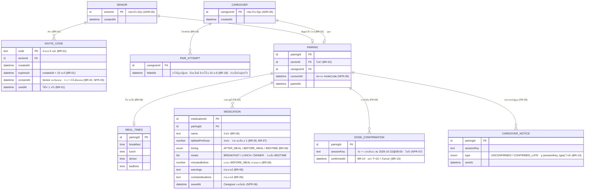

<!-- เจ้าของ: C (Takkan Khanlui · System Designer)
     v1.0 A (YAR OO) ร่างด้วย Claude Code และ commit แทนเจ้าของ ตามที่ทีมตัดสิน 22/10/69 — C ต้องอ่าน/แก้
     §8 สัญญาข้อมูล = ข้อตกลงร่วมของเจ้าของโมดูลทุกคน (A–E) · เปลี่ยนต้องแจ้งทุกคน -->

# Architecture & Design — MedMind v2

อ้างอิง: `docs/02-requirements/spec.md` (FR/BR/NFR/AC — ต้นฉบับ) · `docs/03-design/design-system.md` (หน้าจอ) · `prototype/README.md` (วิธีเขียนโค้ด)
ทุกกล่อง ทุกเส้น ทุกฟิลด์ในเอกสารนี้อ้าง FR/BR/NFR ได้ · ส่วนที่ไม่มี requirement รองรับ = ไม่ออกแบบ

---

## 1. Architecture — 3 ชั้น

รูปแบบ: **Monolith + Layered (3 ชั้น)** ทั้งระบบรันในเบราว์เซอร์ของผู้ใช้ · ไม่มี server (ADR-06)
ชั้นบนเรียกชั้นถัดลงไปผ่านสัญญาเท่านั้น (§8) · ชั้นตรรกะไม่แตะหน้าจอ · ชั้นข้อมูลไม่รู้ว่าใครเรียก

| ชั้น | หน้าที่ | ห้าม | FR/NFR |
|---|---|---|---|
| Presentation | แสดงผล รับ input แสดง feedback/error/empty state ตาม AC ✗ | ตัดสินกฎเอง (เช่น คำนวณเวลาเตือน) | FR-01–05 · NFR-02, 03 |
| Logic | กฎทั้งหมด: รหัสเชิญ/จับคู่ · ร่างจากฉลาก/เวลาเตือน · รอบเตือน/ยืนยัน/แจ้งผู้ดูแล | อ่านเวลาเครื่องเอง (`Date.now()`) · แตะ DOM | BR-01–17 · NFR-01, 04–07, 10 |
| Data | เก็บ entity ใน §5 · ล้างทั้งหมดได้ | เก็บร่างจากฉลากก่อนกดบันทึก (BR-04) · เก็บข้อมูลที่ระบุตัวบุคคล (NFR-09) | NFR-06, 09, 10 |

### 1.1 Deployment view

- ไม่มีข้อมูลยาหรือรูปฉลากออกนอกเครื่อง (NFR-09) — GitHub Pages ส่งแค่ไฟล์โปรแกรม
- ข้ามเครื่องไม่เห็นข้อมูลกัน (SRS §2.2) · prototype จำลอง 2 เครื่องด้วย 2 โทรศัพท์ในหน้าเดียว หรือ 2 แท็บในเบราว์เซอร์เดียว (ADR-06)

---

## 2. Architecture Decision Records

รูปแบบ: Context (FR/NFR ที่บังคับ) · Decision · Consequence · **ทางเลือกที่ปฏิเสธ + เหตุผล** · สถานะ

**ADR-01 — เว็บแอป เตือนเฉพาะขณะเปิดหน้าเว็บค้างไว้** · ยอมรับ
- *Context:* FR-03 ต้องเตือนพร้อมเสียง · ทีมมีเวลา 1 สัปดาห์ (SCHEDULE) · prototype ต้องเปิดในเบราว์เซอร์ (M3)
- *Decision:* เว็บแอป · เตือนและแจ้ง Caregiver เฉพาะขณะหน้าเว็บเปิดอยู่ · เสียงเล่นได้หลังผู้ใช้แตะหน้าครั้งแรก
- *Consequence:* ไม่ต้องมี server/push · ปิดหน้าหรือล็อกจอ = ไม่เตือน (เขียนเป็นข้อจำกัดใน SRS §2.2 · ทบทวนใน M4)
- *ปฏิเสธ:* แอปมือถือ native — เกินเวลาและเกณฑ์ M3 ขอเว็บ · Web Push — ต้องมี server + service worker ซึ่งเกินขอบเขต (constitution หลักการ II)

**ADR-02 — กฎเวลาอยู่ในโมดูลตรรกะ รับเวลาจาก clock** · ยอมรับ
- *Context:* NFR-01 ต้องพิสูจน์ T+5, T+10, T+15 ทุกครั้ง · AC มีค่าขอบ (T+15 พอดี, รหัสหมดอายุนาทีที่ 10)
- *Decision:* ทุกฟังก์ชันกฎรับ `now` เป็นพารามิเตอร์ · prototype ใช้นาฬิกาจำลอง (`src/core/clock.js`) ที่เดินหน้าเท่านั้น · แถบทดลองเลื่อนเวลาได้
- *Consequence:* unit test ทุก AC ได้ในไม่กี่มิลลิวินาที · สาธิตครบ 3 รอบเตือนใน demo 4 นาทีได้
- *ปฏิเสธ:* ตั้ง `setTimeout` ต่อการเตือนแต่ละครั้งด้วยเวลาจริง — test ต้องรอจริง 15 นาที และ demo ทำไม่ได้

**ADR-03 — อ่านฉลากในเบราว์เซอร์ หลัง adapter `readLabel` ได้แค่ "ร่าง"** · ยอมรับ
- *Context:* FR-02 (ผู้ให้สัมภาษณ์ 2 อยากถ่ายฉลาก) · BR-04 ห้ามเดา · NFR-09 ห้ามส่งข้อมูลยาออกนอกเครื่อง · NFR-08/11 ต้องวัดกับฉลากจริง
- *Decision:* OCR ในเบราว์เซอร์ (ไลบรารีใน `prototype/vendor/`) → `labelParser` แยกเป็นช่องร่าง · ช่องที่แยกไม่ได้ = ว่าง + "กรุณาตรวจสอบ" · บันทึกเมื่อ Caregiver กดบันทึกเท่านั้น · อ่านไม่ได้ → ฟอร์มว่าง (FR-02 ✗5)
- *Consequence:* ไม่มี API key ไม่มี server · รูปไม่ออกนอกเครื่อง · ความแม่นของฉลากไทยจริงยังไม่รู้ (วัด ส. 24 ต.ค.) · เปลี่ยนตัวอ่านได้โดยแก้แค่ `readLabel`
- *ปฏิเสธ:* OCR บน cloud — ต้องมี server เก็บ API key และส่งรูปฉลาก (ข้อมูลสุขภาพ) ออกนอกเครื่อง ขัด NFR-09 · ไม่มี OCR กรอกเองอย่างเดียว — ไม่ตอบความต้องการของผู้ให้สัมภาษณ์ 2

**ADR-04 — ทุกระเบียนผูกกับ Pairing** · ยอมรับ
- *Context:* NFR-04 Caregiver เห็นเฉพาะคู่ของตัวเอง · BR-17 + NFR-10 ยกเลิกจับคู่ = ลบข้อมูลของคู่นั้นทั้งหมด
- *Decision:* Medication, MealTimes, DoseConfirmation, CaregiverNotice มี `pairingId` · ทุกการอ่านผ่าน `canAccess` · `unpair` ลบทุกระเบียนที่มี `pairingId` นั้น
- *Consequence:* ทดสอบ NFR-04 และ NFR-10 ได้ที่ฟังก์ชันเดียว
- *ปฏิเสธ:* ผูกข้อมูลกับผู้ใช้แต่ละคน — Senior ไม่มีบัญชี (BR-02) และลบข้อมูลของคู่ได้ยากกว่า

**ADR-05 — ระบุตัวด้วยรหัสเครื่อง ไม่มีบัญชีทั้งสองฝั่ง** · ยอมรับ
- *Context:* BR-02 Senior ไม่มีบัญชี · ผู้ให้สัมภาษณ์ 3 ไม่สะดวกสมัครบัญชี · NFR-09 เก็บข้อมูลน้อยที่สุด
- *Decision:* Senior และ Caregiver มีแค่รหัสเครื่องที่สุ่มขึ้น · ไม่มีชื่อ อีเมล รหัสผ่าน เบอร์โทร
- *Consequence:* ไม่มีหน้าเข้าสู่ระบบ · เปลี่ยนเครื่องหรือล้างข้อมูลเบราว์เซอร์ = จับคู่ใหม่ (FR-01)
- *ปฏิเสธ:* บัญชีอีเมล/รหัสผ่านของ Caregiver — เก็บข้อมูลส่วนตัวเพิ่มโดยไม่มี FR ต้องใช้

**ADR-06 — prototype จำลอง 2 เครื่องในเบราว์เซอร์เดียว** · ยอมรับ (Foundation 22/10/69)
- *Context:* ไม่มี server (ADR-01) แต่ FR-01, FR-05 ต้องเห็น 2 ฝั่งคุยกัน · LESSONS-FROM-V1: หน้าเลือกบทบาท (R0) ไม่มี FR
- *Decision:* หน้า `index.html` แสดง 2 โทรศัพท์ใช้ข้อมูลร่วม · `?role=senior` / `?role=caregiver` เปิดคนละแท็บ ซิงก์ข้อมูล เวลาจำลอง และการล้างข้อมูลผ่านที่เก็บของเบราว์เซอร์
- *Consequence:* demo เห็นทั้ง 2 ฝั่งพร้อมกัน · ทุกหน้ารันกฎพร้อมกัน → ผลของกฎต้องเขียนแบบทำซ้ำไม่เพิ่ม (§8.4) · ข้ามเครื่องจริงไม่ได้
- *ปฏิเสธ:* หน้าเลือกบทบาท — เพิ่มหน้าจอที่ไม่มี FR · ซิงก์ข้ามเครื่องจริงด้วย server — เป็นงาน M4

**ADR-07 — QR อ่านจากรูป + รหัส 6 หลักเป็นทางสำรอง** · ยอมรับ
- *Context:* FR-01 ✓3 สแกน QR · FR-01 ✗7 อ่าน QR ไม่ได้/ไม่อนุญาตกล้อง · ต้องเปิดแบบดับเบิลคลิกได้
- *Decision:* Caregiver ถ่าย/เลือกรูป QR → อ่านในเบราว์เซอร์ (jsQR) · ไม่ได้ → ช่องใส่รหัส 6 หลัก · QR เก็บข้อความ `MEDMIND:<รหัส 6 หลัก>` เท่านั้น
- *Consequence:* ทำงานได้ทั้ง `file://` และ HTTPS (ทดสอบแล้ว · TEAM-PLAN 5.1) · ไม่มีข้อมูลส่วนตัวใน QR
- *ปฏิเสธ:* สแกนสดจากวิดีโอกล้อง — ต้องใช้ HTTPS เสมอ โค้ดซับซ้อนกว่า และไม่จำเป็นต่อ AC
- *เพิ่ม 22/10 (plan 001 · research R-1):* สร้าง QR ด้วย `qrcode-generator@1.4.4` (MIT, ไฟล์เดียวใน vendor) → `qrMatrix` วาดลง canvas (ไม่ใช้ innerHTML) · ทดสอบไป-กลับกับ jsQR ใน node ผ่าน ·
  *ปฏิเสธ:* เขียนตัวเข้ารหัส QR เอง (Reed–Solomon ยาว ผิดง่าย) · CDN (ไม่มีเน็ตใช้ไม่ได้) · ไม่มี QR (ไม่ผ่าน ✓1/✓3)

**ADR-08 — ส่งงานเป็นลิงก์ GitHub Pages + ทางสำรองดับเบิลคลิกที่อ่านฉลากได้** · **เสนอ — รอทีมยืนยัน (B, D) และคำตอบอาจารย์ (A)**
- *Context:* เกณฑ์ M3 "เปิดด้วยดับเบิลคลิก" · OCR โหลดไฟล์ภาษาไม่ได้ผ่าน `file://` · มือถือต้องใช้ HTTPS เพื่อเปิดกล้อง
- *Decision (เสนอ):* ลิงก์หลัก = GitHub Pages · ดับเบิลคลิกยังอ่านฉลากได้โดยฝังไฟล์ภาษา/worker เป็น script (ทดลองแล้ว 22/10: อ่านข้อความไทย 3 บรรทัดถูก ~0.45 วินาที · `HANDOFF.md`)
- *Consequence:* หน้าเว็บโหลดเพิ่ม ~12 MB · วิธีแก้บั๊กไลบรารีผูกกับรุ่น 5.1.1 · ยังไม่ได้ทดสอบกับรูปถ่ายฉลากจริง
- *ปฏิเสธ:* ดับเบิลคลิกอย่างเดียว (ไม่มี OCR) — FR-02 ✓1 ทำงานไม่ได้ · Live Server/server ในเครื่อง — ผู้ตรวจต้องติดตั้งเพิ่ม

---

## 3. Use Case Diagram

เส้นทึบ = association (actor ↔ use case) เท่านั้น · ไม่มี «include»/«extend» เพราะไม่มีพฤติกรรมที่ใช้ร่วมหรือเกิดแบบมีเงื่อนไขระหว่าง use case ที่ต้องแยกออกมา

ตรงกับ SRS §5 (UC-1–7) · NFR ไม่เป็น use case เพราะเป็นข้อกำหนดคุณภาพ

---

## 4. Sequence Diagrams

### 4.1 เตือน → ยืนยัน → แจ้งผู้ดูแล (FR-03 → FR-04 → FR-05) — flow ที่ยากที่สุด
ตัวอย่างมื้อ T = 08:00 · เวลาตรงกับ AC ใน SRS

### 4.2 เพิ่มยาจากฉลาก (FR-02)

### 4.3 จับคู่ (FR-01)

---

## 5. State Machine — มื้อยา (DoseSession · หนึ่งเวลาเตือนของหนึ่งวัน)

สถานะ **คำนวณ** จากเวลา + DoseConfirmation (`statusOf`) ไม่ได้เก็บเป็นฟิลด์ (§6)

- กด "ยังไม่กิน" รอบ 1–2 = อยู่ "กำลังเตือน" รอรอบถัดไป · รอบ 3 = แจ้งผู้ดูแลทันที แต่สถานะยังเป็น "กำลังเตือน" จนถึง T+15 (BR-11)
- กด "กินแล้ว" ซ้ำใน "กินแล้ว" → ไม่สร้างบันทึกใหม่ (BR-12, NFR-07)
- มื้อเวลาซ้อนกัน: แต่ละมื้อเดินตามแผนภาพนี้แยกกัน (BR-16)
- ช่วงยืนยันช้า = ถึงเวลาเตือนของมื้อถัดไปที่เริ่มหลัง T+15 ของมื้อนี้ ไม่มี = ถึง 23:59 (BR-15)
- คำบนหน้าสถานะ = ชื่อสถานะในแผนภาพนี้ตรงตัว (BR-14)

---

## 6. Data Model (tech-agnostic)

เก็บเฉพาะข้อมูลที่ FR-01–05 ใช้ · **ไม่มี** ชื่อคน เลขบัตรประชาชน ที่อยู่ วันเกิด เบอร์โทร HN (NFR-09) · ไม่เก็บรูปฉลากและร่าง (BR-04)
**ค่าที่คำนวณได้ไม่เป็นฟิลด์:** เวลาเตือนของยา · มื้อยาของวัน · สถานะมื้อ · รอบเตือน · ข้อความแจ้ง → เป็น operation ใน §8

| Entity | FR | ฟิลด์ทุกตัวมีที่มา | สร้าง / ลบ |
|---|---|---|---|
| SENIOR, CAREGIVER | FR-01 | ADR-05 | สร้างเมื่อเปิดครั้งแรก · ล้างข้อมูลเบราว์เซอร์ = หาย |
| INVITE_CODE | FR-01 | BR-01, BR-02 | `newInvite` · ใช้แล้ว/หมดอายุไม่ถูกใช้ซ้ำ · Senior มีรหัสที่ยังไม่ใช้ ≤ 1 |
| PAIR_ATTEMPT | FR-01 | BR-18 | `pair` เพิ่มเมื่อถูกปฏิเสธ · ล้างของผู้ดูแลนั้นเมื่อจับคู่สำเร็จ · สถานะล็อกและเวลาที่เหลือคำนวณ ไม่เก็บ |
| PAIRING | FR-01 | BR-02, NFR-04, NFR-05 | `pair` · `unpair` ลบพร้อมทุกระเบียนที่มี `pairingId` เดียวกัน (BR-17, NFR-10) |
| MEAL_TIMES | FR-02, FR-03 | BR-06 | Caregiver ตั้งครั้งแรกตอนเพิ่มยา |
| MEDICATION | FR-02, FR-03 | BR-04–07 | บันทึกเมื่อกดบันทึกเท่านั้น (NFR-06) |
| DOSE_CONFIRMATION | FR-04, FR-05 | BR-10, 12, 15 | 1 ระเบียนต่อมื้อ (NFR-07) |
| CAREGIVER_NOTICE | FR-05 | BR-11, 13, 15 | 1 ระเบียนต่อ (มื้อ, ชนิด) (BR-13, NFR-01) |

**มื้อยา (DoseSession) ไม่ใช่ entity ที่เก็บ:** คำนวณจาก MEDICATION + MEAL_TIMES ของวันนั้น — ยาที่เวลาเตือนตรงกันรวมเป็นมื้อเดียว (BR-06)
**ตัดจาก v1:** ฟิลด์ความถี่ วันเริ่ม/สิ้นสุด (ไม่มี FR) · `reminderTime`, `status`, `round`, `caregiverAlertedAt` (คำนวณได้ / ซ้ำกับ CAREGIVER_NOTICE)

---

## 7. Modules — cohesion / coupling

| Module (`prototype/src/modules/`) | FR | เจ้าของ | เขียน entity | อ่าน entity | ใช้ module อื่น |
|---|---|---|---|---|---|
| `pairing` | FR-01 | A | SENIOR, CAREGIVER, INVITE_CODE, PAIR_ATTEMPT, PAIRING · ลบทุกอย่างของคู่ (BR-17) | — | — |
| `qrScan` | FR-01 | A | — | — | — (vendor jsQR) |
| `readLabel` | FR-02 | B | — | — | — (vendor Tesseract) |
| `labelParser` | FR-02 | B (+A ช่วย) | — | — | — |
| `medication` | FR-02 | B | MEDICATION, MEAL_TIMES | — | — |
| `doseSession` | FR-03 | C | — | MEDICATION, MEAL_TIMES, DOSE_CONFIRMATION | — |
| `confirm` | FR-04 | D | DOSE_CONFIRMATION | — | `doseSession` |
| `escalation` | FR-05 | E | CAREGIVER_NOTICE | DOSE_CONFIRMATION | `doseSession` |

- **Cohesion:** กฎของ FR หนึ่งอยู่ในโมดูลเดียว · เขียน entity ของตัวเองเท่านั้น
- **Coupling:** โมดูลเป็นฟังก์ชันล้วน รับข้อมูลเป็นพารามิเตอร์ คืนข้อมูลใหม่ — ไม่อ่าน/เขียน store เอง (หน้าจอเป็นคนเขียน) · พึ่งกันทางเดียว `confirm`/`escalation` → `doseSession`
- **Event:** ไม่ใช้ส่ง state ระหว่างโมดูล (ทุกหน้าอ่านจาก store · ADR-06) · ใช้ได้เฉพาะสัญญาณภายในหน้า เช่น เล่นเสียง

---

## 8. สัญญาข้อมูล (interface ของแต่ละโมดูล)

ข้อตกลงร่วมของ A–E · ทุกคนเขียนและ test โมดูลของตัวเองด้วยข้อมูลจำลองตามสัญญานี้ได้โดยไม่ต้องรอกัน

### 8.1 รูปแบบค่า
- เวลา (`datetime`) = มิลลิวินาทีจาก clock (ADR-02) · เวลาในวัน (`time`) = ข้อความ `"HH:MM"` · วัน = `"YYYY-MM-DD"` (เวลาท้องถิ่น)
- `sessionKey` = `"YYYY-MM-DD@HH:MM"` (วัน + เวลาเตือน T)
- ฟังก์ชันที่ "เขียน" คืน **รายการใหม่** ไม่แก้รายการที่รับมา · ผิดเงื่อนไขคืน `{ ok: false, reason }` ไม่ throw (throw เฉพาะเมื่อเรียกผิดรูปแบบ)
- ข้อความภาษาไทยบนหน้าจออยู่ในหน้าจอ ยกเว้นคำสถานะ (BR-14) และข้อความแจ้ง (BR-13, BR-15) ที่ต้องตรงทุกที่ → `escalation.statusLabel` / `noticeText` · และเหตุผลปฏิเสธการจับคู่ที่ AC FR-01 ✗5 ✗7 ✗8 กำหนดข้อความตรงตัว → `pairing.reasonText` (plan 001 · research R-6)

### 8.2 ชุดข้อมูลใน store (prototype)
ชื่อชุดข้อมูล ↔ entity §6 · หน้าจอเป็นผู้อ่าน/เขียนผ่าน `ctx.app.store`

| ชุดข้อมูล | ค่า | entity | เขียนโดยหน้าจอของ |
|---|---|---|---|
| `devices` | `{ seniorId, caregiverId }` | SENIOR, CAREGIVER | A |
| `invites` | `InviteCode[]` | INVITE_CODE | A |
| `pairAttempts` | `PairAttempt[]` (`{ caregiverId, failedAt }`) | PAIR_ATTEMPT | A |
| `pairing` | `Pairing` หรือไม่มี | PAIRING | A |
| `mealTimes` | `{ pairingId, breakfast, lunch, dinner, bedtime }` | MEAL_TIMES | B |
| `medications` | `Medication[]` | MEDICATION | B |
| `confirmations` | `DoseConfirmation[]` | DOSE_CONFIRMATION | D |
| `notices` | `CaregiverNotice[]` | CAREGIVER_NOTICE | E |

### 8.3 Operations

**`pairing` (A · FR-01)**
| Operation | Input | Output | กฎ / AC |
|---|---|---|---|
| `newInvite(invites, seniorId, now, random)` | `random()` คืน 0–1 (test ส่งค่าคงที่) | `{ invite, invites }` · `invite` = `InviteCode` (consentAt, usedAt = null) · `invites` = ชุดเดิมที่ลบรหัสที่ยังไม่ได้ใช้ของ `seniorId` แล้ว + `invite` (clarify 22/10) | BR-01 · ✓1 · รหัสเดิมที่ยังไม่ใช้ → `pair` ได้ `'NOT_FOUND'` |
| `ensureDevices(devices, now, random)` | `devices` หรือ `undefined` | `{ seniorId, caregiverId, createdAt }` เติมเฉพาะที่ขาด | ADR-05 |
| `currentInvite(invites, seniorId)` · `isExpired(invite, now)` | | รหัสที่ยังไม่ใช้ หรือ `null` · `now ≥ expiresAt` | BR-01 |
| `consent(invites, code, now)` | | `{ ok: true, invites }` (ใส่ consentAt) หรือ `{ ok: false, reason: 'NOT_FOUND' \| 'EXPIRED' \| 'USED' }` | BR-02 · NFR-05 |
| `pair(state, code, caregiverId, now)` | `state = { invites, pairing, pairAttempts }` | `{ ok: true, pairing, invites, pairAttempts }` (ล้างครั้งผิดของผู้ดูแลนี้) หรือ `{ ok: false, reason, pairAttempts, retryAt? }` · `reason` ตรวจตามลำดับและคืนข้อแรกที่ไม่ผ่าน: `'LOCKED'` (ไม่ตรวจรหัส ไม่เพิ่มครั้งผิด · มี `retryAt`) → `'NOT_FOUND'` → `'EXPIRED'` → `'USED'` → `'NO_CONSENT'` → `'ALREADY_PAIRED'` (5 ข้อหลังเพิ่มครั้งผิด 1 ครั้ง) (clarify 22/10) | ✓3 · ✗2 ✗4 ✗5 ✗8 · หมดอายุเมื่อ `now ≥ expiresAt` · ล็อกเมื่อ L = ครั้งผิดล่าสุด มีครั้งผิด ≥ 5 ในช่วง `(L − 10 นาที, L]` และ `now < L + 10 นาที` → `retryAt = L + 10 นาที` (BR-18 · แก้ 22/10 ตาม research R-3: นับจาก `now` ทำให้ปลดล็อกก่อนเวลา) · ตัดครั้งผิดที่ `failedAt ≤ now − 10 นาที` (NFR-09) |
| `lockedUntil(pairAttempts, caregiverId, now)` | | datetime หรือ `null` | BR-18 · ✗8 (หน้าจอแสดงเวลาที่เหลือก่อนผู้ใช้กด) |
| `minutesLeft(retryAt, now)` | | จำนวนเต็ม ≥ 1 (ปัดขึ้น) | ✗8 "กรุณารอ N นาที" |
| `canAccess(pairing, caregiverId)` · `isSeniorPaired(pairing, seniorId)` | | boolean | NFR-04 · FR-05 ✗7 · หน้าจออื่นกลับ C1/S1 เมื่อถูกยกเลิก |
| `unpair(data, pairingId)` | `data` = ชุดข้อมูลทั้งหมด §8.2 | ชุดข้อมูลที่ลบทุกระเบียนของ `pairingId` แล้ว | BR-17 · ✗6 · NFR-10 |
| `reasonText(reason, minutesLeft?)` | `reason` ของ `pair` หรือ `'QR_UNREADABLE'` | ข้อความไทย (✗5 ✗7 ✗8 ตรงตัว) | SC-005 ของ spec 001 |

**`qrScan` (A · FR-01)**: `qrText(code)` → `"MEDMIND:123456"` · `codeFromQr(text)` → `"123456"` หรือ `null` · `readQr(imageData)` → `codeFromQr(...)` หรือ `null` (✗7) · `qrMatrix(code)` → ตาราง boolean ของโมดูล QR (✓1 · ADR-07) · หน้าจอวาดลง canvas
รายละเอียดเต็ม: `specs/001-pairing/contracts/pairing-module.md`

**`readLabel` (B · FR-02 · adapter)**: `readLabel(file)` → `Promise<{ ok: true, text } | { ok: false, reason: 'UNSUPPORTED_PAGE' | 'UNREADABLE' }>` (✗5)

**`labelParser` (B · FR-02)**: `parseLabel(text)` → `Draft = { name, tabletsPerDose, timing, meals, minutesBefore, warnings, contraindications, asNeeded, needsCheck: [ชื่อช่อง] }`
— ช่องที่แยกไม่ได้ = `null` และอยู่ใน `needsCheck` (BR-04 ห้ามเดา) · ✓1 ✗3 ✗10

**`medication` (B · FR-02)**
| Operation | Output | กฎ / AC |
|---|---|---|
| `validateDraft(draft, mealTimes)` | `{ ok: true }` หรือ `{ ok: false, reason: 'MISSING' \| 'AS_NEEDED', fields: [...] }` | BR-05, BR-07 · ✗3 ✗4 ✗10 |
| `reminderTimes(med, mealTimes)` | `["HH:MM", ...]` หรือ `null` ถ้าข้อมูลไม่พอ | BR-06 · ✓6 ✓8 ✓9 |
| `saveMedication(list, draft, pairingId, now, id)` | `{ ok, medications }` (ไม่ผ่าน validate = ไม่บันทึก) | ✓2 · NFR-06 |

**`doseSession` (C · FR-03)**
| Operation | Output | กฎ / AC |
|---|---|---|
| `sessionsOf(medications, mealTimes, day)` | `[{ sessionKey, at: datetime, medicationIds }]` เรียงตามเวลา · ยาเวลาเดียวกันรวมมื้อเดียว | BR-06 · ✓1 · ✗5 (ไม่มียา = `[]`) |
| `roundAt(session, now)` | `0` ก่อน T · `1` T · `2` T+5 · `3` T+10 · `null` ตั้งแต่ T+15 | BR-08 · ✗2 |
| `dueSessions(sessions, confirmations, now)` | มื้อที่กำลังเตือนและยังไม่ยืนยัน เรียงตามเวลา | ✓3 · ✗4 (BR-16) |
| `lateUntil(session, sessions)` | datetime สิ้นสุดช่วงยืนยันช้า | BR-15 |
| `statusOf(session, sessions, confirmations, now)` | `'WAITING' \| 'ALERTING' \| 'TAKEN' \| 'TAKEN_LATE' \| 'UNCONFIRMED'` | §5 · BR-14 |

**`confirm` (D · FR-04)**
| Operation | Output | กฎ / AC |
|---|---|---|
| `confirm(confirmations, session, sessions, pairingId, now)` | `{ ok: true, confirmations, late }` หรือ `{ ok: false, reason: 'ALREADY' \| 'NOT_STARTED' \| 'TOO_LATE' }` (`ALREADY` ไม่เพิ่มระเบียน) | BR-10, 12, 15 · ✓1 ✗2 ✓5 ✗6 · NFR-07 |
| `notYet(session, now)` | `'WAIT'` (รอบ 1–2) หรือ `'NOTIFY'` (รอบ 3) | BR-11 · ✓3 ✗4 |

**`escalation` (E · FR-05)**
| Operation | Output | กฎ / AC |
|---|---|---|
| `addNotice(notices, session, type, pairingId, now)` | รายการใหม่ · มี (sessionKey, type) อยู่แล้ว = คืนรายการเดิม | BR-13 · ✓5 · NFR-01 |
| `escalate(sessions, confirmations, notices, pairingId, now)` | `notices` + UNCONFIRMED ของทุกมื้อที่ถึง T+15 แล้วยังไม่ยืนยัน | BR-13 · ✓1 ✗2 |
| `dailyStatus(sessions, confirmations, now)` | `[{ sessionKey, time, status, confirmedAt }]` · ไม่มีมื้อ = `[]` | BR-14 · ✓3 ✗4 |
| `statusLabel(status, confirmedAt)` | "กินแล้ว 07:04" / "กินแล้ว (ยืนยันช้า) 08:40" / "กำลังเตือน" / "ยังไม่ยืนยัน" / "รอถึงเวลา" | BR-14 |
| `noticeText(notice)` | "ยังไม่ยืนยันการกินยา" / "ยืนยันการกินยาแล้ว เวลา HH:MM" — ไม่มีคำว่า "ไม่ได้กิน" | BR-13, BR-15 · ✓6 |

### 8.4 ใครรันกฎตามเวลา
หน้าที่เปิดอยู่ทุกหน้า (ADR-06) เรียกตอนเวลาจำลองเปลี่ยน: `escalation.escalate(...)` แล้วเขียน `notices` เฉพาะเมื่อผลต่างจากเดิม
— `addNotice` / `confirm` ทำซ้ำแล้วไม่เพิ่ม จึงไม่แจ้งซ้ำแม้เปิดหลายแท็บ (BR-13, NFR-07) · ตัวเรียกรวมอยู่ที่หน้าจอ C3 และ S2 (E, C ตกลงกันตอน implement)

### 8.5 ข้อตกลงหน้าจอเรื่องสิทธิ์และการยกเลิกจับคู่ (NFR-04, NFR-10 · ตัดสิน 22/10 · plan 001 research R-8)
บังคับทุกหน้าจอที่อ่านข้อมูลของคู่ · รายละเอียด `specs/001-pairing/contracts/screens.md`
- C2 (B), C3 (E): ตอน render และใน `ctx.subscribe` → `!pairing.canAccess(pairing, devices.caregiverId)` → `ctx.go('C1', { notice: 'UNPAIRED' })` · `isStart` = `canAccess(...)`
- S2 (C), S3 (D): `!pairing.isSeniorPaired(pairing, devices.seniorId)` → `ctx.go('S1')` · S3 มีทางไป S1 เพื่อยกเลิกการจับคู่
- ทุกระเบียนของ `mealTimes`, `medications`, `confirmations`, `notices` มี `pairingId` → `unpair` ลบได้ครบ
- *ปฏิเสธ:* hook ทั้งแอปใน shell — เพิ่มกลไกใน Foundation ทั้งที่ R7 ให้ทุก feature เรียกตัวตรวจสิทธิ์อยู่แล้ว

---

## 9. Coverage + Traceability

### 9.1 FR → Operation → Entity → Screen
| FR | Operation | Entity (C/R/U/D) | Screen |
|---|---|---|---|
| FR-01 | `newInvite` · `consent` · `pair` · `lockedUntil` · `canAccess` · `unpair` · `qrText` · `readQr` | INVITE_CODE (C, U) · PAIR_ATTEMPT (C, R, D) · PAIRING (C, R, D) · `unpair` D ทุก entity ของคู่ | S1, C1 |
| FR-02 | `readLabel` · `parseLabel` · `validateDraft` · `reminderTimes` · `saveMedication` | MEDICATION (C) · MEAL_TIMES (C, U) | C2 |
| FR-03 | `sessionsOf` · `roundAt` · `dueSessions` | MEDICATION (R) · MEAL_TIMES (R) · DOSE_CONFIRMATION (R) | S2 |
| FR-04 | `confirm` · `notYet` · `lateUntil` · `statusOf` | DOSE_CONFIRMATION (C, R) | S2, S3 |
| FR-05 | `escalate` · `addNotice` · `dailyStatus` · `statusLabel` · `noticeText` · `canAccess` | CAREGIVER_NOTICE (C, R) · DOSE_CONFIRMATION (R) | C3 |

### 9.2 Coverage (ไม่มี FR ไร้ที่อยู่ · ไม่มีส่วนเกิน)
| FR / NFR | ADR | Use case §3 | Sequence §4 | State §5 | Entity §6 | Module §7 |
|---|---|---|---|---|---|---|
| FR-01 | 04, 05, 07 | UC-1, UC-7 | 4.3 | — | SENIOR, CAREGIVER, INVITE_CODE, PAIR_ATTEMPT, PAIRING | `pairing`, `qrScan` |
| FR-02 | 03, 08 | UC-2 | 4.2 | — | MEDICATION, MEAL_TIMES | `readLabel`, `labelParser`, `medication` |
| FR-03 | 01, 02 | UC-3 | 4.1 | รอถึงเวลา → กำลังเตือน | (คำนวณ) | `doseSession` |
| FR-04 | 02 | UC-4 | 4.1 | กินแล้ว · ยืนยันช้า | DOSE_CONFIRMATION | `confirm` |
| FR-05 | 02, 06 | UC-5, UC-6 | 4.1 | ยังไม่ยืนยัน | CAREGIVER_NOTICE | `escalation` |
| NFR-01 | 02 | — | 4.1 | §5 | CAREGIVER_NOTICE | `escalation` |
| NFR-04, 05, 10 | 04, 05 | UC-1, UC-7 | 4.3 | — | PAIRING, INVITE_CODE | `pairing` |
| NFR-06, 09 | 03, 05 | UC-2 | 4.2 | — | §6 ทั้งหมด | `medication` |
| NFR-07 | — | — | 4.1 | หมายเหตุ §5 | DOSE_CONFIRMATION | `confirm` |
| NFR-08, 11 | 03, 08 | UC-2 | 4.2 | — | — | `readLabel`, `labelParser` |
| NFR-02, 03 | — | — | — | — | — | หน้าจอ (`design-system.md`) |

ทุก Must FR มีที่อยู่ ≥ 4 ส่วน · FR-06–08 (Should/Could) ยังไม่ออกแบบ (SRS §3.6) · ทุก entity และฟิลด์อ้าง FR/BR/NFR ได้ (§6)
