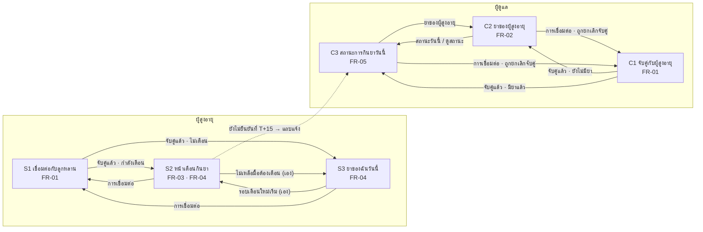
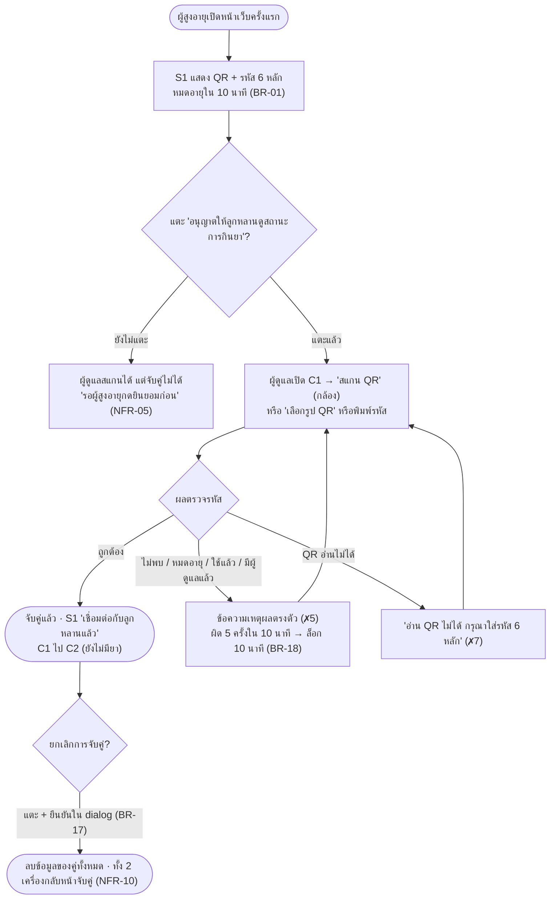
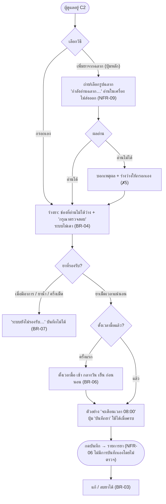
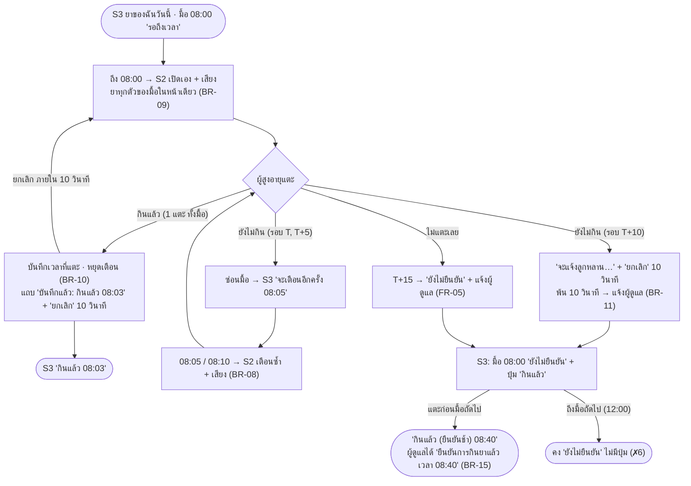
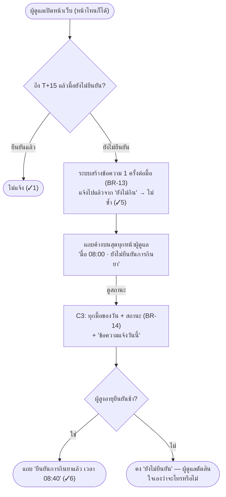

# User Flow + Wireframe — MedMind

<!-- เจ้าของ: D (Rossatorn Sangkaew) · ร่างโดย A ตามที่ทีมตัดสิน 23/10/69 · รวบรวม 25/10/69 -->

**ใช้กับ:** M2 Design (ขั้น UI 4 ขั้น: User flow → Wireframe → Design system → Prototype) · **ต้นฉบับ requirement:** `docs/02-requirements/spec.md`
**เอกสารคู่กัน:** [`architecture.md`](architecture.md) (ระบบ · sequence · state) · [`design-system.md`](design-system.md) (tokens · components · screen map)

> **ที่มา:** flow และโครงหน้าจอในไฟล์นี้กำหนดไว้ก่อนเขียนโค้ดใน `specs/00N-*/contracts/screens.md` ของแต่ละ feature
> (Spec Kit: spec → plan → contract → implement) · ไฟล์นี้รวบรวมไว้ที่เดียวและตรวจกับ prototype จริงแล้ว 25/10/69 ·
> ทุกกล่อง ทุกปุ่ม อ้าง FR/BR/NFR ได้ — ไม่มีหน้าจอที่ requirement ไม่ได้ขอ (constitution II)

---

## 1. ผู้ใช้ งานหลัก และหน้าจอ

| ผู้ใช้ | คำถามที่ต้องตอบ (Charter) | งานหลัก | หน้าจอ |
|---|---|---|---|
| **ผู้สูงอายุ** (Senior) · ไม่มีบัญชี ไม่ต้องพิมพ์ | "มื้อนี้ต้องกินยาอะไร และกินแล้วหรือยัง?" | ① ยินยอมเชื่อมต่อ ② รับเตือน ③ แตะ "กินแล้ว" | S1 → S2 ⇄ S3 |
| **ผู้ดูแล** (Caregiver) | "วันนี้กินยาครบทุกมื้อหรือยัง โดยไม่ต้องโทรถาม?" | ① จับคู่ ② เพิ่มยาจากฉลาก ③ รับแจ้ง / ดูสถานะ | C1 → C2 ⇄ C3 |

| รหัส | ชื่อบนจอ | FR (ป้าย `Covers:`) | ไฟล์ |
|---|---|---|---|
| S1 | เชื่อมต่อกับลูกหลาน | FR-01 · NFR-03, 05 | `prototype/src/screens/pairing.js` |
| S2 | หน้าเตือนกินยา | FR-03, FR-04 · NFR-01, 02, 03, 07 | `prototype/src/screens/reminder.js` |
| S3 | ยาของฉันวันนี้ | FR-04, FR-03 · NFR-02, 03, 07 | `prototype/src/screens/home.js` |
| C1 | จับคู่กับผู้สูงอายุ | FR-01 · NFR-04, 05 | `prototype/src/screens/pairing.js` |
| C2 | ยาของผู้สูงอายุ | FR-02, FR-05 · NFR-06, 09 | `prototype/src/screens/medication.js` |
| C3 | สถานะการกินยาวันนี้ | FR-05 · NFR-01, 04 | `prototype/src/screens/status.js` |

6 หน้าจอ = 5 Must FR · ไม่มีหน้าเลือกบทบาท หน้าเข้าสู่ระบบ หรือหน้าตั้งค่า (ไม่มี FR · ADR-05, ADR-06)

---

## 2. แผนที่หน้าจอ (ทั้งระบบ)

หน้าแรกของแต่ละเครื่องเลือกจากสถานะ ไม่ต้องให้ผู้ใช้เลือก (shell: หน้าแรกที่ `isStart` เป็นจริง)



เส้นทึบ = ผู้ใช้แตะ หรือระบบพาไปเองตามป้าย · เส้นประ = ข้อมูลข้ามเครื่องผ่านที่เก็บร่วม (ADR-06)

---

## 3. User flow ของงานหลัก

### 3.1 จับคู่ 2 เครื่อง (FR-01 · BR-01, 02, 17, 18 · NFR-04, 05)



### 3.2 เพิ่มยาจากฉลาก (FR-02 · BR-03–07 · NFR-06, 09)



### 3.3 ผู้สูงอายุ 1 มื้อ (FR-03 + FR-04 · BR-08–12, 15, 16)



### 3.4 ผู้ดูแลรับแจ้งและดูสถานะ (FR-05 · BR-13–16 · NFR-01, 04)



ไม่มีคำว่า "ไม่ได้กิน" ในทุก flow (BR-13 · constitution V) — ระบบรู้แค่การกดยืนยัน ไม่รู้ว่ากินจริงหรือไม่

---

## 4. ไทม์ไลน์ 1 มื้อ — สองเครื่องพร้อมกัน

ตัวอย่างมื้อเช้า 08:00 ที่ผู้สูงอายุลืม แล้วมายืนยันทีหลัง · ปัญหาที่แก้อ้างจาก `evidence/interviews-2569-09-04.md`

| เวลา | ผู้สูงอายุ | ผู้ดูแล | กฎ | ปัญหาเดิมที่แก้ |
|---|---|---|---|---|
| 07:00 | S3 "รอถึงเวลา" | C3 "รอถึงเวลา" | BR-14 | — |
| 08:00 | S2 เปิดเอง + เสียง | C3 "กำลังเตือน" | BR-08, 09 | ลืมกินยา (ผู้ให้สัมภาษณ์ 1) |
| 08:05 · 08:10 | เตือนซ้ำ + เสียง | — | BR-08 | ปิดเสียงเตือนแล้วลืม |
| 08:15 | S3 "ยังไม่ยืนยัน" + ปุ่ม "กินแล้ว" | แถบ "ยังไม่ยืนยันการกินยา" ขึ้นเอง | BR-13 · NFR-01 | ต้องโทร/LINE ถาม 5–6 ครั้ง/สัปดาห์ (ผู้ให้สัมภาษณ์ 2) |
| 08:40 | แตะ "กินแล้ว" (ยืนยันช้า) | แถบ "ยืนยันการกินยาแล้ว เวลา 08:40" | BR-15 | ไม่ต้องโทรตามต่อ |
| ทั้งวัน | ไม่ต้องพิมพ์ ไม่มีบัญชี | C3 สรุปทุกมื้อของวัน | BR-02 · BR-14 | ไม่ถนัดเทคโนโลยี (ผู้ให้สัมภาษณ์ 3) · วิธีเดิมสรุปสถานะไม่ได้ |

---

## 5. Wireframe (low-fi)

กล่องและป้ายเท่านั้น ไม่มีสี — สี ตัวอักษร และระยะอยู่ใน `design-system.md` · `[[ ปุ่ม ]]` = ปุ่มหลัก (1 ปุ่มต่อหน้าจอ) · `[ ปุ่ม ]` = ปุ่มรอง ·
`_ปุ่ม_` = ปุ่มลิงก์ (ghost) · `( ป้าย )` = ป้ายสถานะ · `▌` = แถบข้อความ (banner) · บรรทัดบนสุดของทุกจอ = ป้าย `Covers:` (constitution I)

### S1 · เชื่อมต่อกับลูกหลาน (FR-01)

```
┌──────────────────────────────┐   ┌──────────────────────────────┐
│ ผู้สูงอายุ · Covers: FR-01 …  │   │ ผู้สูงอายุ · Covers: FR-01 …  │
│ เชื่อมต่อกับลูกหลาน            │   │ เชื่อมต่อกับลูกหลาน            │
├──────────────────────────────┤   ├──────────────────────────────┤
│ ให้ลูกหลานสแกน QR นี้          │   │ ┌──────────────────────────┐ │
│ หรือใส่รหัสด้านล่าง             │   │ │ เชื่อมต่อกับลูกหลานแล้ว     │ │
│        ┌──────────┐          │   │ │ เชื่อมต่อเมื่อ 07:02 · …   │ │
│        │  ▓▓ QR ▓▓ │          │   │ └──────────────────────────┘ │
│        └──────────┘          │   │ [ กลับหน้าแรก ]               │
│       4 8 2  9 1 7           │   │ [ ยกเลิกการจับคู่ ] → dialog  │
│ รหัสหมดอายุเวลา 07:10         │   │                              │
│ เมื่ออนุญาต ลูกหลานจะเห็น…      │   │                              │
│ [[ อนุญาตให้ลูกหลานดูสถานะ… ]] │   │                              │
│ [ สร้างรหัสใหม่ ]              │   │                              │
└──────────────────────────────┘   └──────────────────────────────┘
   ยังไม่จับคู่ (✓1 · NFR-05)            จับคู่แล้ว (✓3 · BR-17)
```
Error: รหัสหมดอายุ → `▌รหัสหมดอายุแล้ว` + `[[ สร้างรหัสใหม่ ]]` (BR-01)

### S2 · หน้าเตือนกินยา (FR-03, FR-04)

```
┌──────────────────────────────┐   ┌──────────────────────────────┐
│ ผู้สูงอายุ · Covers: FR-03 …  │   │ ผู้สูงอายุ · Covers: FR-03 …  │
│ หน้าเตือนกินยา                 │   │ หน้าเตือนกินยา                 │
├──────────────────────────────┤   ├──────────────────────────────┤
│ ▌แตะหน้าจอ 1 ครั้งเพื่อเปิดเสียง │   │ 06:45                         │
│ 08:00                (เวลาใหญ่)│   │ (ยังไม่ยืนยัน) เลยเวลาแล้ว      │
│ (กำลังเตือน) ถึงเวลากินยา       │   │ ┌ OMEPRAZOLE 20 MG ─────────┐ │
│ ┌ AMLODIPINE 5 MG ──────────┐ │   │ └ ครั้งละ 1 เม็ด ────────────┘ │
│ │ ครั้งละ 1 เม็ด              │ │   │ [[ กินแล้ว ]]   ← ปุ่มหลักมื้อแรก│
│ └ ข้อควรระวัง: …  ───────────┘ │   │ ───────────────────────────── │
│ ┌ METFORMIN 500 MG ─────────┐ │   │ 07:00                         │
│ └ ครั้งละ 2 เม็ด ────────────┘ │   │ (กำลังเตือน) ถึงเวลากินยา       │
│                              │   │ ┌ AMLODIPINE 5 MG ──────────┐ │
│ [[        กินแล้ว        ]]  │   │ └ ครั้งละ 1 เม็ด ────────────┘ │
│ [        ยังไม่กิน        ]  │   │ [ กินแล้ว ]                   │
│  ↑ สูง ≥ 64 px กว้างเต็มจอ     │   │ [ ยังไม่กิน ]                  │
│ _การเชื่อมต่อ_                 │   │ _การเชื่อมต่อ_                 │
└──────────────────────────────┘   └──────────────────────────────┘
   1 มื้อ (✓1 · BR-09 · NFR-03)         มื้อซ้อน (FR-03 ✗4 · BR-16)
```
หลังแตะ: แถบ `▌บันทึกแล้ว: กินแล้ว 08:03 [ ยกเลิก ]` หรือ `▌จะแจ้งลูกหลานว่ายังไม่ยืนยันการกินยา [ ยกเลิก ]` บนสุด 10 วินาที (R1b)

### S3 · ยาของฉันวันนี้ (FR-04)

```
┌──────────────────────────────┐   ┌──────────────────────────────┐
│ ผู้สูงอายุ · Covers: FR-04 …  │   │ ผู้สูงอายุ · Covers: FR-04 …  │
│ ยาของฉันวันนี้                 │   │ ยาของฉันวันนี้                 │
├──────────────────────────────┤   ├──────────────────────────────┤
│ ▌จะเตือนอีกครั้ง 08:05  (ถ้ามี)│   │                              │
│ ┌────────────────────────────┐ │   │   ยังไม่มียา                   │
│ │ 08:00                      │ │   │   ให้ผู้ดูแลเพิ่มยา             │
│ │ AMLODIPINE 5 MG · METFORMIN│ │   │                              │
│ │ (ยังไม่ยืนยัน)               │ │   │                              │
│ │ [[        กินแล้ว       ]] │ │   │                              │
│ └────────────────────────────┘ │   │                              │
│ ┌────────────────────────────┐ │   │                              │
│ │ 12:00                      │ │   │                              │
│ │ METFORMIN 500 MG           │ │   │                              │
│ │ (รอถึงเวลา)                 │ │   │                              │
│ └────────────────────────────┘ │   │                              │
│ _การเชื่อมต่อ_                 │   │ _การเชื่อมต่อ_                 │
└──────────────────────────────┘   └──────────────────────────────┘
   ยืนยันช้า (✓5 · BR-14, 15)            ว่าง (FR-03 ✗5 ตรงตัว)
```
ป้ายสถานะ 5 แบบ (BR-14): `(กินแล้ว 08:03)` `(กินแล้ว (ยืนยันช้า) 08:40)` `(กำลังเตือน)` `(ยังไม่ยืนยัน)` `(รอถึงเวลา)` · ปุ่ม "กินแล้ว" เฉพาะมื้อในช่วงยืนยันช้า

### C1 · จับคู่กับผู้สูงอายุ (FR-01)

```
┌──────────────────────────────┐
│ ผู้ดูแล · Covers: FR-01 …     │
│ จับคู่กับผู้สูงอายุ              │
├──────────────────────────────┤
│ ▌การจับคู่ถูกยกเลิกแล้ว (ถ้ามี) │
│ สแกน QR บนโทรศัพท์ของผู้สูงอายุ │
│ [[          สแกน QR       ]]  │
│ _เลือกรูป QR จากเครื่อง_         │
│ รหัส 6 หลัก                    │
│ ┌──────────────────────────┐ │
│ │ ______                   │ │
│ └──────────────────────────┘ │
│ ตัวเลขเท่านั้น                  │
│ [ เชื่อมต่อ ]  (ใช้ได้เมื่อครบ 6) │
└──────────────────────────────┘
```
Error: `▌ไม่พบรหัสนี้ …` · `▌รหัสนี้หมดอายุแล้ว …` · `▌รอผู้สูงอายุกดยินยอมก่อน …` · `▌ใส่รหัสผิดหลายครั้ง กรุณารอ N นาที` (✗2 ✗4 ✗5 ✗8)

### C2 · ยาของผู้สูงอายุ (FR-02)

```
┌──────────────────────────────┐   ┌──────────────────────────────┐
│ ผู้ดูแล · Covers: FR-02 · FR-05│   │ ผู้ดูแล · Covers: FR-02 · FR-05│
│ ยาของผู้สูงอายุ                 │   │ ยาของผู้สูงอายุ                 │
├──────────────────────────────┤   ├──────────────────────────────┤
│ ▌มื้อ 08:00 · ยังไม่ยืนยัน…     │   │ ▌ตรวจทุกช่องก่อนบันทึก ระบบ…    │
│  [ ดูสถานะ ]       (FR-05)    │   │ ชื่อยา      [ AMLODIPINE 5 MG ]│
│ [[    เพิ่มยาจากฉลาก     ]]   │   │ ครั้งละกี่เม็ด [ 1 ]             │
│ [ กรอกเอง ]                   │   │ เวลาตามฉลาก [ หลังอาหาร ▾ ]    │
│ ┌ AMLODIPINE 5 MG ──────────┐ │   │ มื้อ  ☑เช้า ☐กลางวัน ☐เย็น     │
│ │ ครั้งละ 1 เม็ด · หลังอาหารเช้า│ │   │ ข้อควรระวัง [ ____________ ]    │
│ │ เตือน 08:00                │ │   │ ข้อห้ามใช้  [ ____________ ]    │
│ │ [ แก้ ] [ ลบ ]             │ │   │   ⚠ กรุณาตรวจสอบ (ช่องที่ว่าง)  │
│ └───────────────────────────┘ │   │ จะเตือนเวลา 08:00              │
│ [ สถานะวันนี้ ]                │   │ [[        บันทึกยา        ]]  │
│ _การเชื่อมต่อ_                 │   │ [ ยกเลิก ]                    │
└──────────────────────────────┘   └──────────────────────────────┘
   รายการ + แถบแจ้ง (FR-05 R11)           ร่างรอตรวจ (✓1 · BR-04)
```
ว่าง: `ยังไม่มียา · ถ่ายรูปฉลากยาจากโรงพยาบาล…` · ไม่รองรับ: `▌ระบบยังไม่รองรับยาเมื่อมีอาการ` (BR-07) · อ่านไม่ได้: ร่างว่าง + กรอกเอง (✗5)

### C3 · สถานะการกินยาวันนี้ (FR-05)

```
┌──────────────────────────────┐   ┌──────────────────────────────┐
│ ผู้ดูแล · Covers: FR-05 …     │   │ ผู้ดูแล · Covers: FR-05 …     │
│ สถานะการกินยาวันนี้              │   │ สถานะการกินยาวันนี้              │
├──────────────────────────────┤   ├──────────────────────────────┤
│ ▌มื้อ 08:00 · ยืนยันการกินยาแล้ว│   │                              │
│  เวลา 08:40   [ รับทราบ ]      │   │   ยังไม่มีมื้อยาวันนี้           │
│ ┌ 08:00 ────────────────────┐ │   │                              │
│ │ AMLODIPINE 5 MG · METFORMIN│ │   │ [ ยาของผู้สูงอายุ ]            │
│ └ (กินแล้ว (ยืนยันช้า) 08:40) ┘ │   │ _การเชื่อมต่อ_                 │
│ ┌ 12:00 ────────────────────┐ │   │                              │
│ │ METFORMIN 500 MG           │ │   │                              │
│ └ (รอถึงเวลา) ───────────────┘ │   │                              │
│ ข้อความแจ้งวันนี้                 │   │                              │
│ 08:40 · มื้อ 08:00 · ยืนยัน…    │   │                              │
│ 08:15 · มื้อ 08:00 · ยังไม่ยืนยัน│   │                              │
│ [ ยาของผู้สูงอายุ ]            │   │                              │
│ _การเชื่อมต่อ_                 │   │                              │
└──────────────────────────────┘   └──────────────────────────────┘
   สถานะทั้งวัน (✓3 ✓6 · BR-14)          ว่าง (✗4 ตรงตัว)
```
ไม่มีปุ่มหลัก (หน้าดูอย่างเดียว) · ไม่ได้จับคู่ → กลับ C1 ไม่แสดงข้อมูลของใคร (✗7 · NFR-04)

---

## 6. ตรวจตามเช็กลิสต์ UI (SE-COURSE-PRINCIPLES หัวข้อ 7)

| เกณฑ์ | ที่ทำในหน้าจอ | ตรวจด้วย |
|---|---|---|
| 1 หน้าจอ = ปุ่มหลัก 1 อัน | S1 อนุญาต / S2 กินแล้ว (มื้อแรก) / S3 กินแล้ว (ปุ่มแรก) / C1 สแกน QR / C2 เพิ่มยา หรือ บันทึกยา / C3 ไม่มี | Chrome อัตโนมัติ นับ `.btn--primary` ทุกสถานะ (ผ่าน) |
| Feedback ทุกการกระทำ | แถบผล + ยกเลิก 10 วินาที · toast · ข้อความเหตุผลเมื่อทำไม่ได้ | ชุด Chrome FR-01–05 |
| การกระทำที่ย้อนไม่ได้ต้องยืนยัน | ยกเลิกการจับคู่ = dialog · ลบยา = dialog · "กินแล้ว"/"ยังไม่กิน" รอบสุดท้าย = ยกเลิกได้ 10 วินาทีแทน dialog (NFR-02 แตะครั้งเดียว · analyze 004) | spec 004 R1b, R11 |
| ทำให้กรอกผิดไม่ได้ | ปุ่ม "เชื่อมต่อ" ใช้ได้เมื่อครบ 6 หลัก · "บันทึกยา" ใช้ได้เมื่อข้อมูลครบ · ยาไม่รองรับบันทึกไม่ได้ | FR-01 ✗, FR-02 ✗3 ✗4 ✗10 |
| Recognition > recall | ผู้สูงอายุไม่ต้องจำว่ากินหรือยัง — S3 บอกทุกมื้อ · ผู้ดูแลไม่ต้องจำว่าถามแล้วหรือยัง — C3 + ข้อความแจ้งวันนี้ | FR-04 R6 · FR-05 R10 |
| Fitts / Hick | ปุ่มของผู้สูงอายุสูง ≥ 64 px กว้างเต็มจอ · หน้าเตือนมีแค่ 2 ทางเลือก | NFR-03 (ผ่าน) |
| Usability เป็นตัวเลข | NFR-02: ผู้สูงอายุ ≥ 4/5 คนยืนยันได้ใน 10 วินาที | **ผลจริง: [ทีมกรอก]** (`docs/04-test/`) |

---

## 7. Traceability ของหน้าจอ

| FR | Flow | Wireframe | Error / empty state | Test |
|---|---|---|---|---|
| FR-01 | 3.1 | S1, C1 | รหัสหมดอายุ · ผิด 5 ครั้งล็อก · QR อ่านไม่ได้ | `pairing.test.js` · `qrScan.test.js` |
| FR-02 | 3.2 | C2 | อ่านฉลากไม่ได้ · ยาไม่รองรับ · ยังไม่มียา | `labelParser.test.js` · `medication.test.js` |
| FR-03 | 3.3 | S2 | ยังไม่มียา (S3) · ยังไม่ได้แตะเปิดเสียง | `doseSession.test.js` |
| FR-04 | 3.3 | S2, S3 | มื้อนี้ยืนยันแล้ว · เลยเวลายืนยัน | `confirm.test.js` |
| FR-05 | 3.4 | C2 (แถบ), C3 | ยังไม่มีมื้อยาวันนี้ · ยังไม่ได้จับคู่ | `escalation.test.js` |
