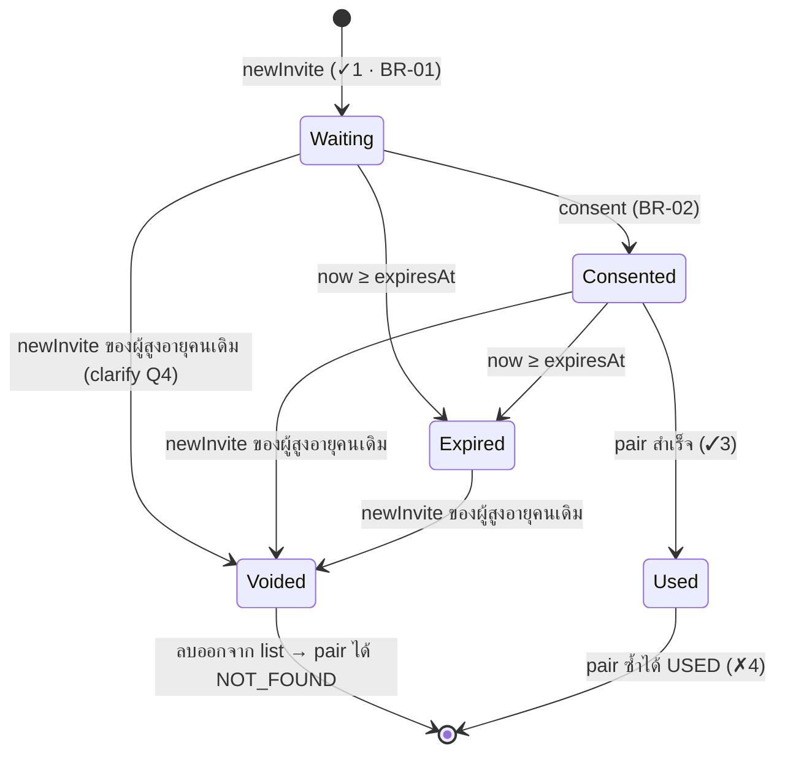

# Data Model: Pairing (FR-01)

**Source**: `docs/03-design/architecture.md` §6 (ERD) และ §8.2 (ชุดข้อมูลใน store) — ไฟล์นี้ขยายกฎตรวจ/สถานะเฉพาะของ FR-01 ไม่ตั้ง entity ใหม่
<!-- เจ้าของ: A (YAR OO) · ร่างโดย Claude Code ตามคำสั่ง /speckit-plan -->

เวลา = มิลลิวินาทีจาก clock (ADR-02) · `MINUTE = 60 000` · ไม่มีชื่อ เบอร์ วันเกิด หรือข้อมูลส่วนตัวในทุก entity (NFR-09, R8)

## Entities

| Entity (ชุดข้อมูลใน store) | ฟิลด์ | กฎตรวจ | ที่มา |
|---|---|---|---|
| **Devices** (`devices`: object เดียว) = SENIOR + CAREGIVER ของ ERD §6 (1 เบราว์เซอร์จำลอง 2 เครื่อง จึงเก็บรวม) | `seniorId`, `caregiverId` (ข้อความสุ่ม `S-`/`C-` + 8 ตัว) · `createdAt` (ใช้แทน `createdAt` ของทั้งสอง entity — สร้างพร้อมกัน) | สร้างครั้งแรกที่เปิด (`ensureDevices`) · ไม่เปลี่ยนจนล้างข้อมูล | ADR-05 · SRS §2.2 (1 เบราว์เซอร์ = 2 เครื่องจำลอง) |
| **InviteCode** (`invites`: list) | `code` (ตัวเลข 6 หลัก ข้อความ) · `seniorId` · `createdAt` · `expiresAt = createdAt + 10 นาที` · `consentAt` (null = ยังไม่ยินยอม) · `usedAt` (null = ยังไม่ใช้) | `code` ไม่ซ้ำใน list · ผู้สูงอายุ 1 คนมีรหัสที่ `usedAt = null` ≤ 1 รหัส · หมดอายุเมื่อ `now ≥ expiresAt` | BR-01, BR-02, NFR-05 · clarify Q4 |
| **PairAttempt** (`pairAttempts`: list) | `caregiverId` · `failedAt` | เพิ่ม 1 รายการต่อการปฏิเสธเหตุผล 1–5 · ไม่เพิ่มเมื่อ `LOCKED` · ลบของผู้ดูแลคนนั้นเมื่อจับคู่สำเร็จ · ลบรายการที่ `failedAt ≤ now − 20 นาที` | BR-18 · research R-3 |
| **Pairing** (`pairing`: object หรือไม่มี) | `pairingId` · `seniorId` · `caregiverId` · `consentAt` (คัดจาก InviteCode) · `pairedAt` | มีได้ 1 รายการต่อผู้สูงอายุ (BR-02) · `consentAt` ต้องไม่ว่าง (NFR-05) | BR-02, NFR-04, NFR-05 |

**ค่าที่คำนวณ ไม่เก็บเป็นฟิลด์:** ล็อกอยู่ไหม / `retryAt` / นาทีที่เหลือ (`lockedUntil`) · รหัสหมดอายุไหม · สถานะหน้าจอ S1/C1 · ข้อความเหตุผล

## ความสัมพันธ์ (ตาม ERD §6)

- Senior 1 — 0..* InviteCode (ใช้ได้พร้อมกันไม่เกิน 1)
- Caregiver 1 — 0..* PairAttempt (ในช่วง 10 นาทีล่าสุด)
- Senior 1 — 0..1 Pairing · Caregiver 1 — 0..1 Pairing
- Pairing 1 — 0..* ข้อมูลของ feature อื่น (`mealTimes`, `medications`, `confirmations`, `notices` ผ่าน `pairingId`) → `unpair` ลบทั้งหมด (BR-17, NFR-10)

## วงจรชีวิตของ InviteCode

<!-- Covers: FR-01 (✓1 ✗2 ✓3 ✗4) · BR-01, BR-02 -->

## สถานะหน้าจอ (คำนวณจากข้อมูล ไม่เก็บ)

| หน้าจอ | สถานะ | เงื่อนไข | ปุ่มหลัก |
|---|---|---|---|
| S1 ผู้สูงอายุ | `PAIRED` | มี `pairing` ของ `seniorId` | — ("ยกเลิกการจับคู่" เป็นปุ่มรอง + dialog ยืนยัน) |
| | `EXPIRED` | รหัสที่ยังไม่ใช้หมดอายุ | "สร้างรหัสใหม่" |
| | `WAITING_CONSENT` | รหัสยังไม่หมดอายุ · `consentAt = null` | "อนุญาตให้ลูกหลานดูสถานะการกินยา" · "สร้างรหัสใหม่" เป็นปุ่มรอง |
| | `WAITING_CAREGIVER` | ยินยอมแล้ว · ยังไม่จับคู่ | — (แสดง "รอผู้ดูแลสแกน") · "สร้างรหัสใหม่" เป็นปุ่มรอง |
| | (ไม่มีรหัสที่ยังไม่ใช้) | เปิดครั้งแรก / หลังยกเลิกการจับคู่ | สร้างรหัสให้ทันที → `WAITING_CONSENT` |
| C1 ผู้ดูแล | `PAIRED` | `canAccess(pairing, caregiverId)` | — ("ยกเลิกการจับคู่" ปุ่มรอง + dialog) |
| | `LOCKED` | `lockedUntil(...) ≠ null` | ปิดการสแกนและช่องรหัส · แสดง "กรุณารอ N นาที" |
| | `READY` | อื่น ๆ | "สแกน QR" · ช่องรหัส 6 หลัก + "เชื่อมต่อ" เป็นทางรอง |
